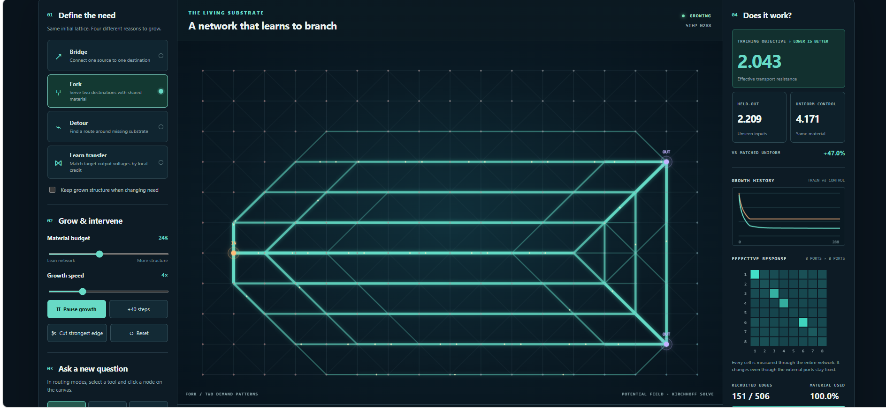

# GrowingMatrix — give it a need; watch it grow



**[Open the live browser laboratory](https://anttiluode.github.io/GrowingMatrix/)** · [Unruh precursor](https://github.com/anttiluode/Unruh)

An interactive, entirely client-side mathematical laboratory for **task-dependent network growth**. Give the same initially weak conducting lattice different demands, and it recruits different connections. You can change the task, retain its learned structure, cut edges, place terminals by clicking nodes, watch the training/held-out objectives, and measure the operator seen by external ports.

No frameworks, no backend, no third-party scripts, no data uploads. The pre-existing `.github/workflows/static.yml` deploys the site to GitHub Pages.

## What to try

1. Open the [live site](https://anttiluode.github.io/GrowingMatrix/) or serve locally with `python -m http.server 8000` and open `http://localhost:8000/` (ES modules require HTTP rather than opening `index.html` directly).
2. Choose **Bridge**, **Fork**, **Detour**, **Learn transfer**, or **Learn attention**. Leave **Keep grown structure** off for independent initial conditions, or turn it on to test adaptation to changed needs.
3. Press **Pause growth**, **+40 steps**, **Cut strongest edge**, or **Reset**. In routing modes, choose **Place source** or **Place sink**, then click a lattice node. A damaged connection stays broken until reset.
4. Inspect the held-out objective against a **uniform material-matched control**, growth history, and the **8×8 external response matrix**. Download a JSON snapshot of every edge and its learned conductance.
5. Press **Benchmark all four needs** to run controlled 240-step experiments without altering the current simulation.

### CLI tests / benchmark

Requires **Node.js 20+** (browser app itself requires only a modern browser):

```sh
npm test
npm run bench
```

## Mathematical model

The fixed two-dimensional *candidate lattice* has nodes and horizontal, vertical and one diagonal edge per square. Dormant edges always carry a weak, fixed `g0=0.025` conducting scaffold; trained edge material `h_e ≥ 0` supplies additional conductance:

\[
g_e=g_0+h_e, \qquad L(h)=B\operatorname{diag}(g)B^\top.
\]

Given a source current vector `b` and a grounded sink `r`, the fast physical-like state is a passive Kirchhoff potential field:

\[
L(h)v=b,\quad v_r=0.
\]

The solver uses preconditioned conjugate gradients on the grounded Laplacian. The fast solve is repeated as the slow material allocation changes. **The graph has no physically growing new nodes**: 'growth' means recruiting and pruning latent edges and adapting continuous conductances. This is a mathematically tractable first gate for actual geometry-dependent development.

### Routing: exact local credit

For one unit of injected current, transport compliance is `R = bᵀv` (effective resistance between terminals). Differentiation through Kirchhoff's law gives:

\[
\frac{\partial R}{\partial h_e}=-(v_a-v_b)^2.
\]

Thus a connection can determine its contribution from the local potential drop, even though the objective is global. For multiple routing demands, average the gradients. For Detour, selected mid-grid candidate edges are removed; for Fork, the need contains two source-to-sink configurations.

### Learn transfer: two-field, supervised growth

For prescribed currents and two output-voltage targets, train

\[
\mathcal L=\tfrac12\sum_{k}\|Cv_k-y^*_k\|^2,
\qquad L(h) v_k=b_k.
\]

The adjoint field solves

\[
L(h)z_k=C^\top(Cv_k-y^*_k),
\]

and each edge gets its own exact negative gradient:

\[
-\frac{\partial\mathcal L}{\partial h_e}=
\sum_k(v_{k,a}-v_{k,b})(z_{k,a}-z_{k,b}).
\]

The demo targets come from a hidden **passive teacher network** with two conductivity corridors. There are four training current patterns and four held-out mixtures. A passive linear network can only implement linear input-output relations; this **does not demonstrate XOR, nonlinear computation, or generalization outside the training span**. The held-out transfer mixes probe linear superposition and numerical optimization, not unfamiliar nonlinear functions.

### Budget-constrained growth

Per iteration, the update follows a *normalized* negative loss gradient, then projects onto

\[
0\le h_e\le 3, \qquad \sum_e \ell_e h_e\le M.
\]

Projection onto this length-weighted capped simplex is computed by scalar bisection on a Lagrange multiplier. At the boundary, useful edges compete for finite material, and weak ones become dormant. Normalize changes effective step size, not the direction of the underlying exact local sensitivity; optimization can still get stuck and is not guaranteed to discover the global optimum in a finite number of steps.

### Effective operator

Eight fixed external measurement ports observe an **8×8 Green/response matrix**. Each entry measures the potential at port `i` produced by unit current at port `j` while a reference node is grounded. The full graph is hidden from that measurement. This matrix changes when latent conductances grow, even if the ports remain fixed. The matrix is symmetric by reciprocity (tested numerically). **This is an inverse grounded-Laplacian response, not a generic neural or quantum state.**

## Reproducible benchmark

`npm run bench` starts all cases from the identical weak scaffold (except for Detour's missing edges), grows for 240 steps, and scores the trained structure against an equal-material **uniform** network. Training and held-out routing demands differ by an endpoint displacement; transfer hold-outs mix basis inputs. Fixed seed, no randomness in optimization.

| Need | Training objective ↓ | Held-out ↓ | Uniform on same held-out demands ↓ |
|---|---:|---:|---:|
| Bridge | 1.65248 | 1.93074 | 3.918 *(approx)* |
| Fork | 2.05110 | 2.21621 | 4.171 *(approx)* |
| Detour | 1.97009 | 2.35937 | 4.849 *(approx)* |
| Learn transfer | 0.00002 | 0.00001 | 9.289 *(approx)* |

Different tasks have different objectives (resistance for routing, squared output error for transfer), so magnitudes are **not cross-task comparable**. Material matched means adaptive material beyond the fixed scaffold is spread uniformly over remaining edges; baseline and trained system share the same scaffold and exclusions. The uniform control is intentionally weak: future comparisons should include shortest-path/Steiner heuristics, topology optimization, and supervised optimizers with comparable structure and computational cost.

## Limitations and next gates

- The current structure recruits conductance along a *pre-existing candidate mesh*. Actual growth of new nodes, neurites, branch points, or geometry requires an additional spatial morphogenesis model.
- The solver is passive and linear. It does not implement spiking neurons, plastic synapses, nonlinear logic, cognition, consciousness, or quantum fields.
- The network uses a global projection enforcing a shared material budget. Most edge-credit information is local, but budget allocation is **not** a fully decentralized biological rule.
- The task / error function is externally provided; supervised growth uses a separate adjoint solve. It does not invent goals autonomously.
- The demo optimization is deterministic and relatively small. Better benchmarks should sweep seeds, network sizes, budgets, disturbances, and held-out target families, and compare CPU and memory usage.
- Cuts are permanent until reset and may isolate portions of the graph. Only designated terminal configurations are evaluated; the demo is not a proof of damage recovery.

**Proposed Gate 2:** let tip cells extend into empty space and allocate material between node birth, edge growth, and strengthening under a finite budget. Test whether genuinely new topologies outperform merely reweighting an existing dense candidate lattice at equal material and compute. **Gate 3:** replace passive fields with dynamical fast waves so development can acquire recurrent state and temporal memory (the Unruh connection).

## Gate 5: Grow an attention operator on a planar lattice

This experiment follows the [Limasieni](https://github.com/anttiluode/Limasieni) result that unrestricted separate query/key ports can express arbitrary strictly positive attention rows, while a reciprocal single-port absorber has reversibility and maximum-principle restrictions.

**GrowingMatrix adds the missing spatial restriction.** Eight query terminals and eight key terminals interact through the existing 17×11 locally connected candidate lattice and the existing length-weighted conductance budget. Choose **Learn attention** on the site, then target **Mirror**, **Shift**, or **Duplicate**. Toggle **Two-port** (query left, key grounded right) and **Single-port** (query and key co-located left), with optional retention of material across task changes.

The current-fraction readout is not the same as the original port-voltage response. With shunt conductances \(s_j\) at key nodes, define

\[
M(h)=B\operatorname{diag}(g_0+h)B^\top+\operatorname{diag}(s), \quad
M(h)v^{(i)}=e_{q_i}, \quad
A_{ij}=s_jv^{(i)}_{k_j}.
\]

All injected current must leave at one of the eight sinks, so each attention row sums to one. Despite reciprocal underlying conductances, the **cross-port current-split matrix can be asymmetric**. The same-node single-port Green response remains symmetric and obeys the maximum principle.

We specify one **fixed** row-stochastic teacher attention matrix \(T\) per task. Mirror and shift are near-permutations with a small nonzero tail; duplicate uses one fixed example of repeated token values, with softer/mixed rows. These are **not** attention matrices computed by a transformer for fresh inputs. The growth objective is mean squared row error:

\[
\mathcal L=\frac{1}{16}\sum_{i,j}(A_{ij}-T_{ij})^2.
\]

The learner uses an adjoint solve for each injected query. If \(M z^{(i)}=\sum_j\frac{s_j}{8}(A_{ij}-T_{ij})e_{k_j}\), the edge's negative gradient is

\[
-\frac{\partial\mathcal L}{\partial h_e}=
\sum_i(v_a^{(i)}-v_b^{(i)})(z_a^{(i)}-z_b^{(i)}).
\]

It then uses GrowingMatrix's original projected gradient and material cap. This is supervised adjoint optimization, not spontaneous Physarum discovery.

### What the gates actually show

Run `npm run bench:attention` (240 steps each, deterministic default lattice and settings):

| Fixed attention target | Two-port planar KL ↓ | Single-port planar KL ↓ | Unrestricted bipartite limit |
|---|---:|---:|---:|
| Mirror | **1.9322** | 2.9500 | 0 |
| Shift | **1.7909** | 1.8883 | 0 |
| Duplicate | **0.5726** | 0.9972 | 0 |

The last column is an *expressivity limit*: 64 independent direct query–key conductances with arbitrarily strong sinks can realize the target rows. It is **not** a spatially or materially matched physical baseline. The planar single and two-port experiments share the **same material budget cap**, but their **actual used material can differ**.

The planar two-port network improves on these separately optimized single-port models but **does not** copy sharp Limasieni-style teacher matrices well. Shared interiors and planar wiring are substantial limitations: mirror and shift retain very high KL, and shift still looks diffuse rather than a permutation. The 240-step setting is a fixed benchmark horizon, not a certificate of global optimality. No node birth occurs.

The browser's four matrix views let you inspect the current-split operator, the target, the co-located control *read from the currently grown material* (not independently retrained), or the old symmetric voltage response. The **Compare three attention targets** button does separately train both layouts. Its **held-out** metric means an alternating ±20% physical sink-conductance perturbation, **not** unseen tokens or contexts.

```sh
npm test
npm run bench
npm run bench:attention
node attention_benchmark.js 500
```

**Next gates:** provide real independent crossing layers at matched cost, investigate topology change and node birth, and above all see whether a **single frozen grown medium** can generate input-dependent useful attention without first computing the conventional \(QK^\top\) matrix. Gate 5 does not run a transformer end-to-end.
